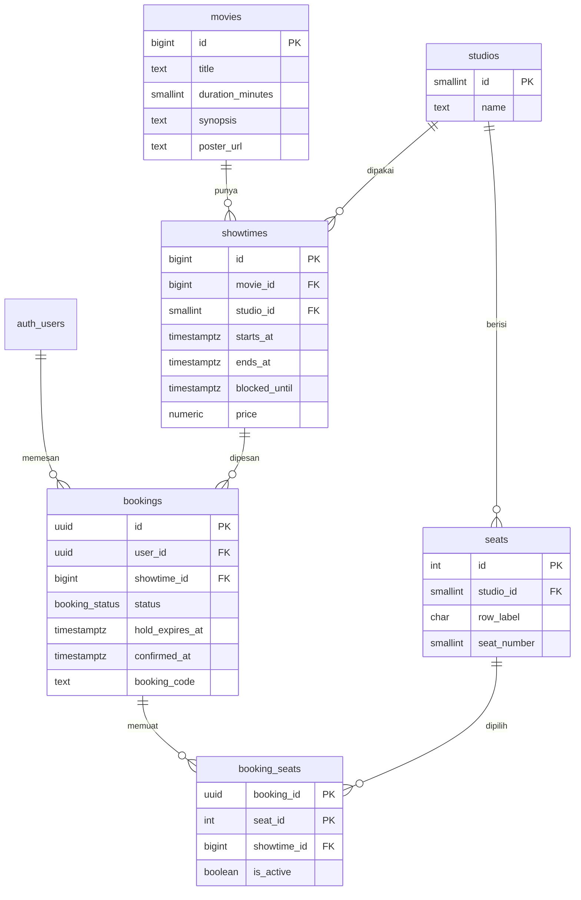

# Cinemovie v1 — Struktur Database

Versi 1.0 · 20 November 2026

Dokumen ini adalah acuan skema Postgres (Supabase) untuk Cinemovie v1. Isinya berasal dari `cinemovie-mvp-v1-brief.md` bagian 8. Tidak ada tabel, kolom, atau aturan baru.

## 1. Prinsip

- Autentikasi memakai Supabase Auth. **Tidak ada tabel `users` atau `profiles`.** `bookings.user_id` mengacu langsung ke `auth.users(id)`.
- Peran admin disimpan di `app_metadata.role = 'admin'`, diisi developer (R11). Penonton tidak bisa mengubah `app_metadata`. Jangan memakai `user_metadata` untuk peran.
- Aturan penting dijaga **di database** (constraint, trigger, fungsi), bukan hanya di antarmuka.
- Penonton tidak menulis langsung ke `bookings` atau `booking_seats`. Semua lewat fungsi.
- Semua waktu bertipe `timestamptz`. Tampilan memakai WIB (`Asia/Jakarta`).
- Kedaluwarsa pesanan dihitung dari waktu server (`hold_expires_at`), bukan dari timer di layar (R3).

## 2. ERD



## 3. Kamus data

| Tabel | Isi | Catatan |
|---|---|---|
| `studios` | 5 studio | Diisi sekali oleh developer (R6) |
| `seats` | 400 kursi tetap | 5 studio × baris A sampai H × nomor 1 sampai 10. Diisi sekali (R6) |
| `movies` | Film: judul, durasi (menit), sinopsis, URL poster | Dikelola admin lewat CMS |
| `showtimes` | Jadwal tayang per film dan studio | `ends_at` dan `blocked_until` diisi trigger. `price` tetap, tidak ada di form CMS (R5) |
| `bookings` | Satu transaksi pemesanan | Status: `held`, `confirmed`, `expired` (R7). Kode booking hanya ada saat `confirmed` |
| `booking_seats` | Kursi yang dimuat satu pesanan | `is_active` menandai kursi yang masih mengunci jadwal |

## 4. DDL

Aktifkan `btree_gist` sebelum menjalankan DDL.

```sql
create extension if not exists btree_gist;

create type booking_status as enum ('held', 'confirmed', 'expired');

create table studios (
  id   smallint primary key generated always as identity,
  name text not null unique
);

create table seats (
  id          int primary key generated always as identity,
  studio_id   smallint not null references studios(id),
  row_label   char(1)  not null check (row_label between 'A' and 'H'),
  seat_number smallint not null check (seat_number between 1 and 10),
  unique (studio_id, row_label, seat_number)
);

create table movies (
  id               bigint primary key generated always as identity,
  title            text not null,
  duration_minutes smallint not null check (duration_minutes > 0),
  synopsis         text not null,
  poster_url       text not null,
  created_at       timestamptz not null default now(),
  updated_at       timestamptz not null default now()
);

create table showtimes (
  id            bigint primary key generated always as identity,
  movie_id      bigint   not null references movies(id),
  studio_id     smallint not null references studios(id),
  starts_at     timestamptz not null,
  ends_at       timestamptz not null,   -- diisi trigger: starts_at + durasi film
  blocked_until timestamptz not null,   -- diisi trigger: ends_at + 15 menit
  price         numeric(10,2) not null check (price >= 0),
  created_at    timestamptz not null default now(),
  -- R10: tidak boleh tumpang tindih, termasuk jeda 15 menit
  constraint showtimes_no_overlap exclude using gist (
    studio_id with =,
    tstzrange(starts_at, blocked_until) with &&
  )
);
create index showtimes_starts_at_idx on showtimes (starts_at);

create table bookings (
  id              uuid primary key default gen_random_uuid(),
  user_id         uuid not null references auth.users(id),
  showtime_id     bigint not null references showtimes(id),
  status          booking_status not null default 'held',
  hold_expires_at timestamptz not null,
  confirmed_at    timestamptz,
  booking_code    text unique,
  created_at      timestamptz not null default now(),
  -- kode dan waktu konfirmasi hanya ada untuk pesanan dikonfirmasi
  check ((status = 'confirmed') = (booking_code is not null and confirmed_at is not null))
);
-- R14: satu penahanan aktif per akun
create unique index bookings_one_hold_per_user on bookings (user_id) where status = 'held';
create index bookings_user_idx     on bookings (user_id, created_at desc);
create index bookings_showtime_idx on bookings (showtime_id);

create table booking_seats (
  booking_id  uuid not null references bookings(id) on delete cascade,
  showtime_id bigint not null references showtimes(id),
  seat_id     int  not null references seats(id),
  is_active   boolean not null default true,
  primary key (booking_id, seat_id)
);
-- R1: satu kursi di satu jadwal hanya untuk satu pesanan aktif
create unique index booking_seats_taken_once
  on booking_seats (showtime_id, seat_id) where is_active;
```

### Harga tetap (R5)

Nilai harga tiket tetap **belum ditetapkan**. Setelah ditetapkan, jadikan nilai bawaan kolom agar form CMS tidak perlu menampilkannya:

```sql
-- alter table showtimes alter column price set default <HARGA_TETAP>;
```

Jangan mengisi angka sebelum nilainya dikonfirmasi (lihat `plan.md` bagian 7).

## 5. Data awal (seed)

```sql
insert into studios (name)
select 'Studio ' || g from generate_series(1, 5) g;

insert into seats (studio_id, row_label, seat_number)
select s.id, chr(64 + r), n
from studios s, generate_series(1, 8) r, generate_series(1, 10) n;
-- hasil: 5 x 80 = 400 kursi
```

Akun admin pertama dibuat developer lewat Supabase Auth, lalu diberi `app_metadata.role = 'admin'` (R11).

## 6. Trigger

```sql
-- Jadwal: isi ends_at dan blocked_until, tolak jam lampau (R9, R10), kunci jadwal berpesanan (R4)
-- security definer: admin tidak punya akses baca ke bookings (RLS), tetapi trigger tetap
-- harus bisa melihat pesanan agar R4 berlaku. Tanpa ini, pengecekan selalu lolos.
create function showtimes_before_write() returns trigger
language plpgsql security definer set search_path = '' as $$
declare d smallint;
begin
  if tg_op = 'UPDATE' and exists (
    select 1 from public.bookings b
    where b.showtime_id = old.id
      and (b.status = 'confirmed'
           or (b.status = 'held' and b.hold_expires_at > now()))
  ) then
    raise exception 'Jadwal sudah punya pesanan dan tidak boleh diubah';
  end if;

  if (tg_op = 'INSERT' or new.starts_at is distinct from old.starts_at)
     and new.starts_at <= now() then
    raise exception 'Jam tayang harus di masa depan';
  end if;

  select duration_minutes into d from public.movies where id = new.movie_id;
  new.ends_at       := new.starts_at + make_interval(mins => d);
  new.blocked_until := new.ends_at + interval '15 minutes';
  return new;
end $$;

create trigger showtimes_before_write
before insert or update on showtimes
for each row execute function showtimes_before_write();

-- Film: durasi tidak boleh diubah jika sudah punya jadwal
create function movies_lock_duration() returns trigger language plpgsql as $$
begin
  if new.duration_minutes <> old.duration_minutes
     and exists (select 1 from showtimes where movie_id = old.id) then
    raise exception 'Durasi tidak bisa diubah karena film sudah punya jadwal';
  end if;
  new.updated_at := now();
  return new;
end $$;

create trigger movies_lock_duration
before update on movies
for each row execute function movies_lock_duration();
```

## 7. Fungsi (RPC) sisi penonton

Semua fungsi memakai `security definer`, dan wajib:

- mengambil identitas dari `auth.uid()` dan menolak jika kosong (jangan menerima `user_id` dari klien),
- menetapkan `search_path` secara eksplisit dan memakai nama tabel yang diawali skema,
- dicabut `execute`-nya dari `public` dan `anon`, lalu diberikan hanya ke `authenticated`.

| Fungsi | Langkah |
|---|---|
| `hold_seats(showtime_id, seat_ids[])` | 1) Tolak jika belum login, jumlah kursi di luar 1 sampai 4, atau sudah lewat batas tutup (`starts_at` dikurangi 5 menit). 2) Pastikan semua kursi milik studio jadwal itu. 3) Lepas penahanan aktif milik akun ini (R14). 4) Lepas penahanan basi di jadwal ini: status jadi `expired` dan `is_active = false`. 5) Buat pesanan `held` dengan `hold_expires_at = least(now() + 5 menit, starts_at - 5 menit)`. 6) Isi `booking_seats`. Jika ada kursi bentrok, unique index melempar error dan seluruh transaksi batal. |
| `confirm_booking(booking_id)` | Pesanan milik akun ini, status `held`, `hold_expires_at > now()`, dan belum lewat batas tutup. Lalu status jadi `confirmed`, isi `confirmed_at`, dan buat `booking_code` acak yang tidak bisa ditebak. |
| `seat_availability(showtime_id)` | Mengembalikan setiap kursi dengan status kosong, ditahan, atau terisi, tanpa data pemesan. |
| `expire_stale_holds()` | Opsional, tiap menit lewat `pg_cron`, hanya sebagai pembersih. Tidak boleh dipanggil dari klien. |

### Status efektif

Karena pembersih bersifat opsional, status dihitung saat dibaca:

| Kondisi pesanan | Status efektif | Mengunci kursi dan jadwal? |
|---|---|---|
| `confirmed` | Dikonfirmasi (terisi) | Ya |
| `held` dan `hold_expires_at > now()` | Ditahan | Ya |
| `held` dan `hold_expires_at <= now()` | Kedaluwarsa | Tidak |
| `expired` | Kedaluwarsa | Tidak |

## 8. Hak akses (RLS)

Aktifkan RLS di semua tabel.

| Tabel | Penonton | Admin |
|---|---|---|
| `movies`, `showtimes`, `studios`, `seats` | Baca | Tambah dan ubah film dan jadwal |
| `bookings` | Baca milik sendiri | Tidak ada akses |
| `booking_seats` | Baca milik sendiri | Tidak ada akses |
| Tulis ke `bookings` / `booking_seats` | Tidak ada, hanya lewat fungsi | Tidak ada |

- Kondisi admin pada policy: `(auth.jwt() -> 'app_metadata' ->> 'role') = 'admin'`.
- Tidak ada policy `delete` untuk `showtimes` karena fitur hapus tidak ada (R4).
- Admin tidak punya akses ke `bookings` karena daftar pesanan oleh admin di luar cakupan.

## 9. Pemetaan aturan ke penegaknya

| Aturan | Dijaga oleh |
|---|---|
| R1 kursi tidak dobel | Unique index parsial `booking_seats_taken_once`, transaksi semua-atau-tidak-sama-sekali |
| R2 maks 4 kursi per transaksi | Pengecekan di `hold_seats` |
| R3 tahan 5 menit, bebas begitu lewat | `hold_expires_at` dan pelepasan penahanan basi di `hold_seats` |
| R4 jadwal berpesanan tidak diubah | Trigger `showtimes_before_write`, tanpa policy delete |
| R7 tiga status | Enum `booking_status` |
| R8 dan R11 hanya admin | RLS pada `app_metadata.role`, akun admin dari seed |
| R9 tutup 5 menit sebelum tayang | `hold_seats` dan `confirm_booking` |
| R10 tidak bentrok, jeda 15 menit | Exclusion constraint `showtimes_no_overlap`, trigger durasi film |
| R14 satu penahanan aktif | Unique index parsial `bookings_one_hold_per_user` |
