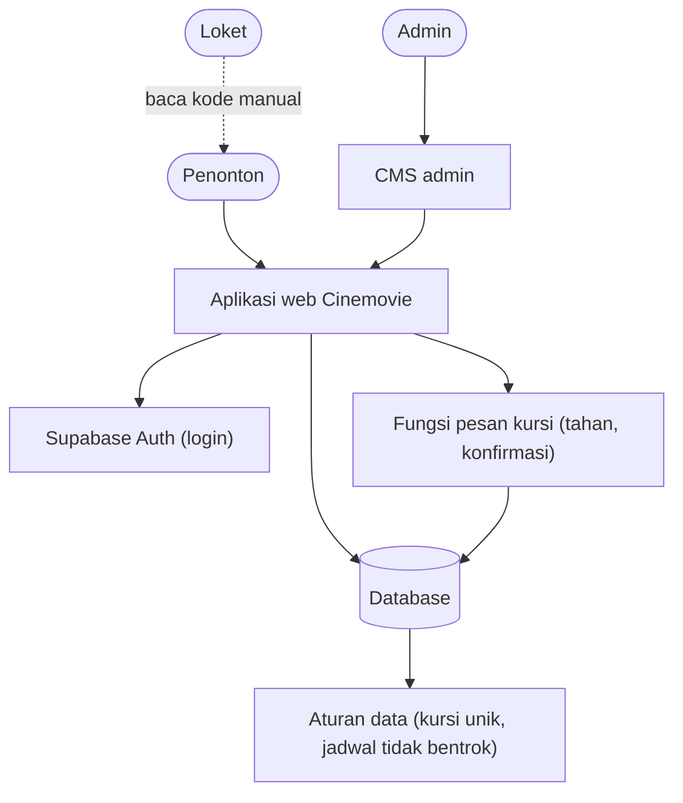
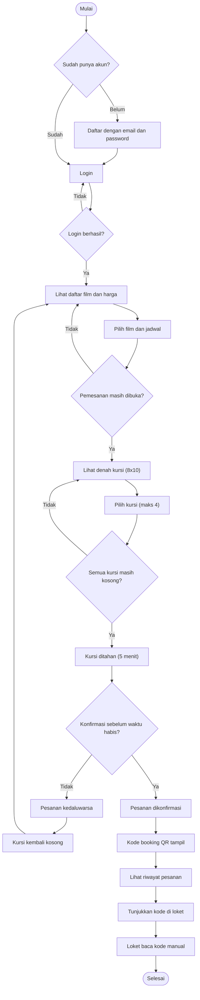
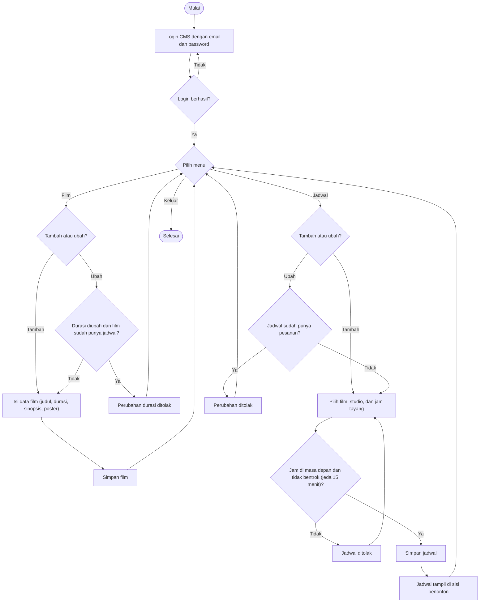
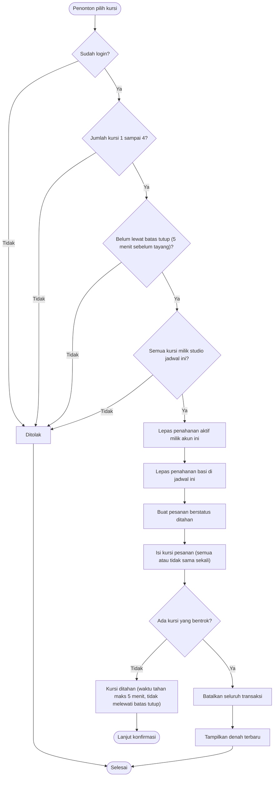
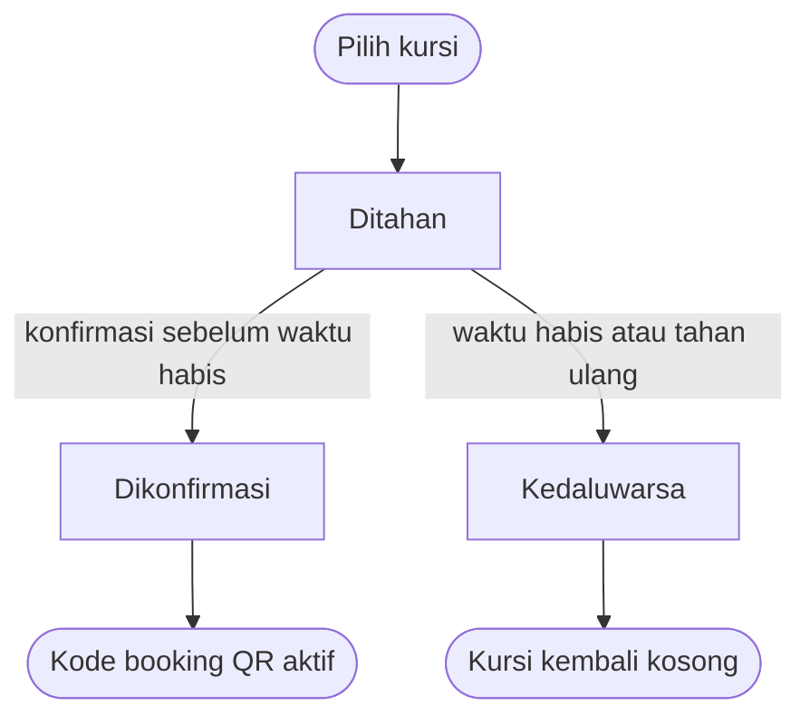
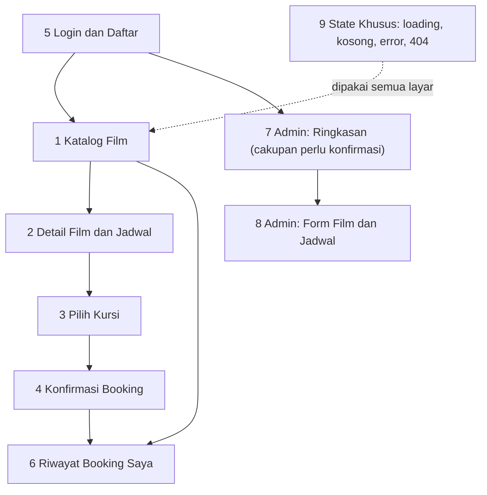

# Cinemovie v1 — Alur Sistem

Versi 1.0 · 20 November 2026

Dokumen ini memuat diagram alur dan peta layar. Isinya berasal dari `cinemovie-mvp-v1-brief.md` dan `design_system_cinemovie.md`. Tidak ada alur baru.

## 1. Gambaran umum

Loket bukan akun di aplikasi. Petugas loket hanya membaca kode booking yang ditunjukkan penonton (R13).

## 2. Alur penonton

## 3. Alur admin

## 4. Alur tahan kursi (inti sistem)

## 5. Status pesanan

Status yang tampil ke pengguna dihitung dari waktu server. Pesanan `held` dengan `hold_expires_at` yang sudah lewat tampil sebagai **Kedaluwarsa**, walau barisnya belum diubah oleh pembersih.

## 6. Peta layar

Sembilan layar mengikuti `design_system_cinemovie.md` bagian 5.

Layar 5 mengarah ke layar 1 sesuai alur brief (login dulu). Catatan konfirmasi untuk layar 7 dan 8 ada di `plan.md` bagian 7.

## 7. Pemetaan layar ke fitur, aturan, dan data

| Layar | Fitur | Aturan | Data atau fungsi |
|---|---|---|---|
| 1 Katalog Film | F2 | R5 | Baca `movies`, `showtimes` |
| 2 Detail Film dan Jadwal | F2 | R9, R12 | Baca `showtimes` |
| 3 Pilih Kursi | F3, F4 | R1, R2, R3, R9, R14 | `seat_availability`, `hold_seats` |
| 4 Konfirmasi Booking | F4 | R3, R9, R13 | `confirm_booking` |
| 5 Login dan Daftar | F1 | R11 | Supabase Auth |
| 6 Riwayat Booking Saya | F5 | R7, R13 | Baca `bookings`, `booking_seats` milik sendiri |
| 7 Admin: Ringkasan | F6 | R8 | Pintu masuk ke layar 8 |
| 8 Admin: Form Film dan Jadwal | F6 | R4, R8, R9, R10, R12 | Tulis `movies`, `showtimes` (admin) |
| 9 State Khusus | Semua | n/a | Tidak ada |

## 8. Pemetaan komponen design system ke layar

| Komponen | Dipakai di layar |
|---|---|
| Navbar | Semua layar (varian penonton dan admin) |
| MovieCard | 1 |
| SeatMap | 3 |
| Card | 2 (kartu jadwal), 4, 6, 7 |
| Table | 7 (lihat catatan konfirmasi), jadwal admin di 8 |
| Input dan Button | 5, 8, dan semua form |
| Badge | 1, 2, 6 |
| Toast | Semua layar (notifikasi aksi) |
| StateMessage | 9 dan semua layar saat loading, kosong, atau error |
